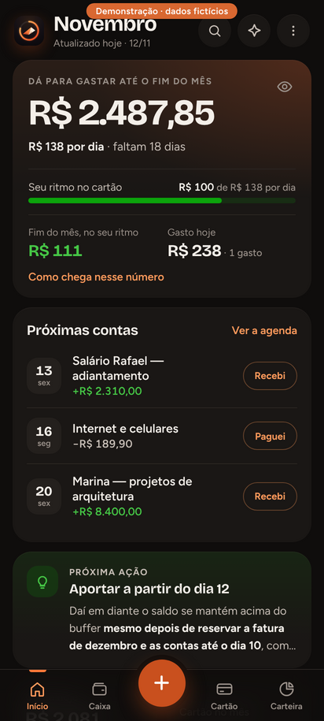
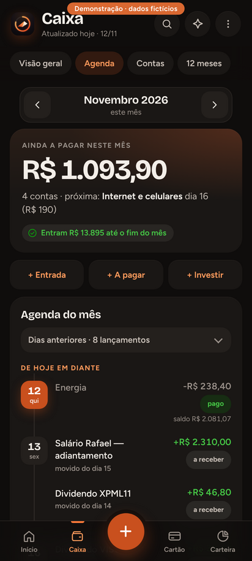
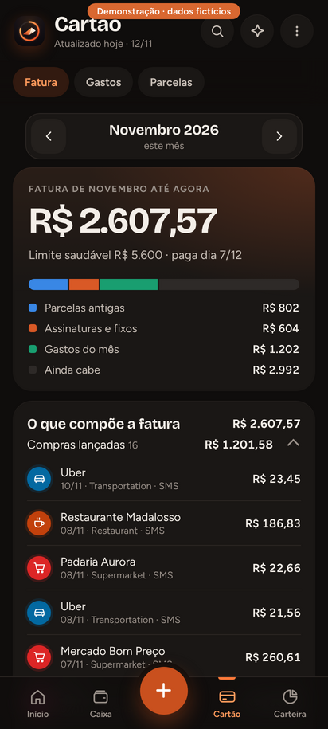
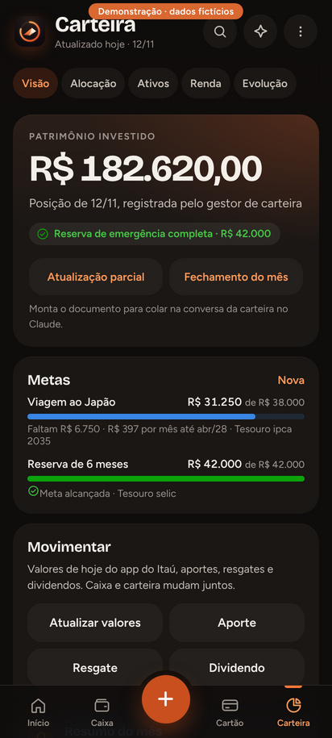
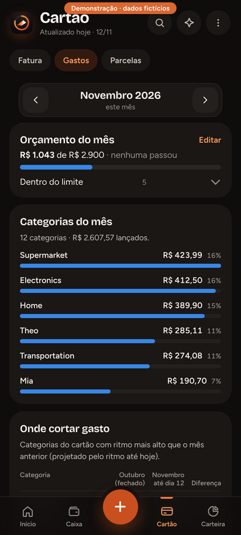
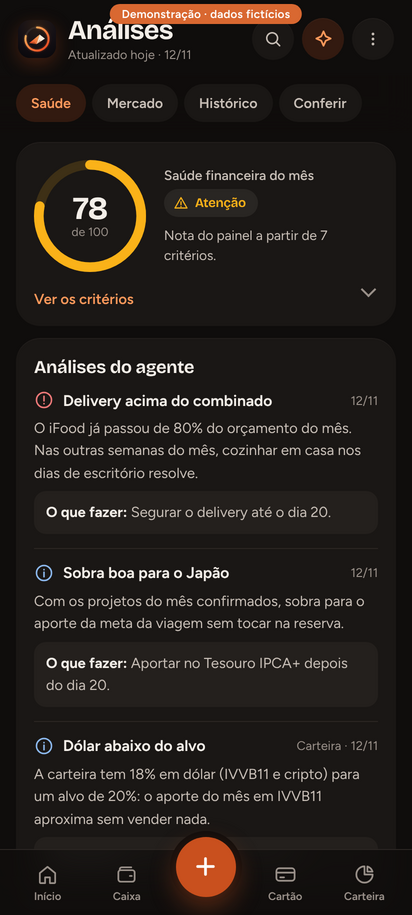
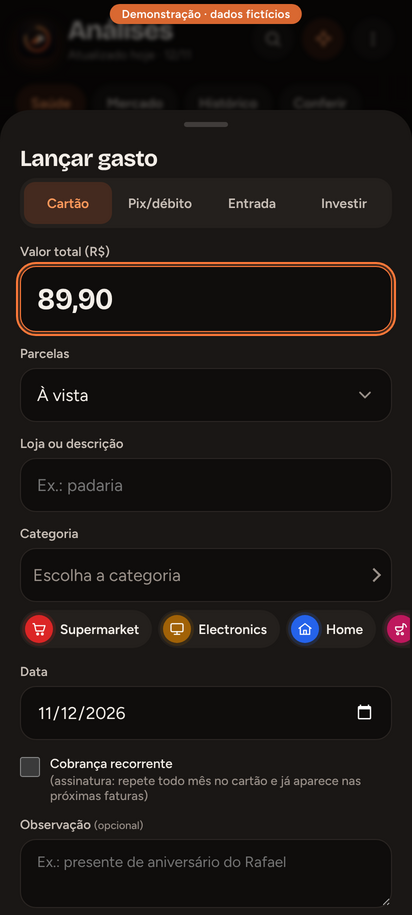
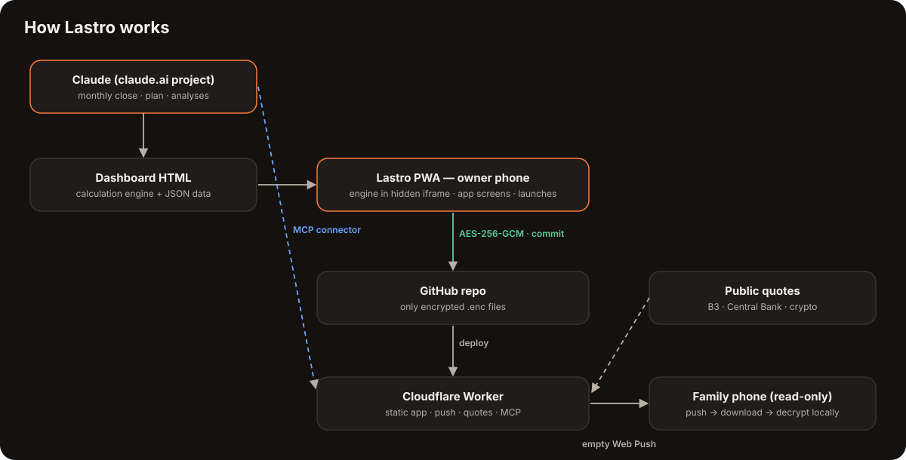
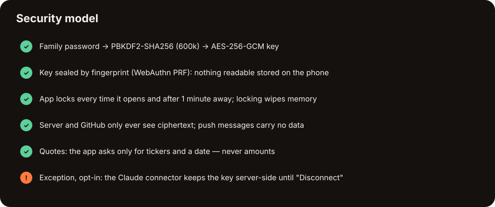

  <a href="https://bebernos.github.io/Lastro-Business/"><b>▶ Live demo</b></a> ·
  <a href="README.pt-BR.md">Leia em português</a> ·
  <a href="docs/architecture.md">Architecture</a> ·
  <a href="SECURITY.md">Security</a> ·
  <a href="docs/case-study.md">Case study</a>

# Lastro

**Lastro is a mobile-first personal finance app (PWA) that puts a family's cash flow, credit card and investment portfolio
in one place — with an AI analyst (Claude) doing the heavy thinking and end-to-end encryption protecting every number.**

It was built for a real family and has been used every day since October 2026: the owner logs card purchases from bank
SMS in two taps, the rest of the family follows everything on their own phones, and once a month the AI closes the books, rebalances
the plan and writes the analyses.

> The live demo runs with a **fictitious family** (Marina, Rafael, Theo and Mia the cat) generated on the fly, with dates
> that always move with today's calendar. Nothing leaves your browser.

## What it does

| | | | |
|:---:|:---:|:---:|:---:|
|  **How much can I still spend?** |  **Month timeline** |  **Credit card, item by item** |  **Investments & goals** |
|  **Any month: past or projected** |  **Budgets by category** |  **AI analyses & health score** |  **Two-tap entry (or paste the SMS)** |

 
<i>A purchase goes in and the "can still spend" number updates immediately — then syncs, encrypted, to the family.</i>

- **Daily cash flow** — what is left to spend this month, the bills calendar, "paid / to receive" with one tap, and a
  12-month projection that shows which months will be tight before they arrive.
- **Credit card** — every purchase, installment and subscription; budgets per category with alerts at 80% and 100%;
  a real Excel export of the bill. Card purchases can be pasted straight from the bank's SMS (several at once).
- **Investments** — portfolio by asset and class, "today's estimate" from live public quotes, dividends, goals, an
  allocation plan, a liquidity ladder (when each part of the money becomes available) and a fixed-income switch simulator.
- **Past and future** — pick any month: closed months can be corrected, future months can receive bills and income.
- **Two phones, one truth** — the owner publishes, the family phone gets a push notification ("3 new entries") and
  decrypts locally.
- **AI where it adds judgment** — monthly closing, plan reviews and analyses are done by Claude, which reads and writes
  the data directly through an **MCP connector** (no files to download or upload).

## How it works

The unusual part: **the calculation engine is an HTML dashboard written by the AI.** Every month Claude produces a
self-contained dashboard (code + JSON data). Lastro loads it in a hidden iframe and calls its functions
(`calc()`, `timeline()`, `projecao12()`…) — the app never re-implements the math, it **translates** the dashboard into
native mobile screens and adds what the dashboard can't do: data entry, sync, encryption, notifications, offline use.
When the AI adds a new block to its dashboard, it shows up in the app on its own.

More in [docs/architecture.md](docs/architecture.md).

## Security

Financial data is encrypted on the phone (AES-256-GCM, key from PBKDF2-SHA256 with 600k iterations) before it ever leaves
it; GitHub and Cloudflare only see ciphertext. On the owner's phone the key is sealed by the fingerprint through
the WebAuthn PRF extension, so nothing readable is stored on the device. Details and the one opt-in exception (the AI
connector) in [SECURITY.md](SECURITY.md).

## Engineering highlights

- **Zero dependencies.** ~13,000 lines of plain JavaScript (ES modules), no framework, no build step — including a
  hand-written `.xlsx` writer, SVG charts and a Web Push (VAPID/ES256) sender.
- **Serverless on free tiers.** Static app + a Cloudflare Worker with a Durable Object (SQLite) for push subscriptions,
  a quote cache and the MCP server. GitHub is the database (encrypted files, one commit per sync).
- **Tested like a product.** A Playwright regression suite (≈260 checks), an end-to-end suite (62 checks: owner logs,
  publishes, the family phone receives, both match) and 30+ unit test files — run against real data shapes before every
  release.
- **Pure functions for every financial operation** (`JSON → JSON`), so undo is exact and each change is auditable.
- **Accessibility and motion care**: contrast ≥ 4.5:1 in both themes, `prefers-reduced-motion`, screen-reader labels.
- **Offline-first PWA**: service worker cache, share target (receive files and SMS text), app shortcuts.

 <i>The same app on a desktop.</i>

## Tech stack

JavaScript (ES2023, no framework) · HTML/CSS · Service Worker · Web Crypto (AES-GCM, PBKDF2, HKDF) · WebAuthn PRF ·
Web Push (VAPID) · IndexedDB · Cloudflare Workers + Durable Objects · GitHub API (Git Data) · Model Context Protocol (MCP) ·
Claude · Playwright · Node.js

## Read more

- [Case study](docs/case-study.md) — the problem, the decisions and what came out of them.
- [Architecture](docs/architecture.md) — data flow, the dashboard-as-engine pattern, sync and the MCP connector.
- [Security](SECURITY.md) — threat model and how each layer works.

## About

Designed and built by **Bruno Bernos** — product, UX and engineering — working with Claude Code as a pair programmer.
Contact: [github.com/BeBernos](https://github.com/BeBernos).

## License

Copyright © 2026 Bruno Bernos. **All rights reserved.** The source is published for evaluation only; no permission is
granted to use, copy, modify or distribute it. See [LICENSE](LICENSE). For commercial interest, get in touch.
