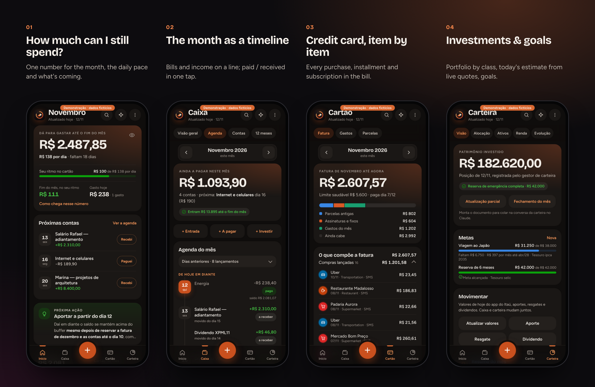
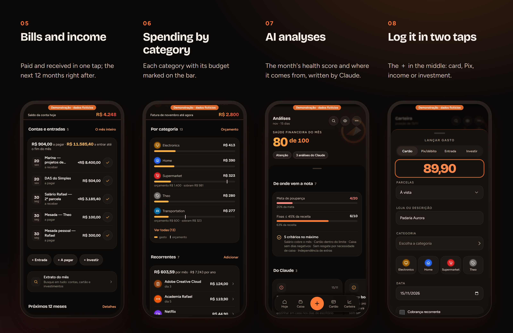
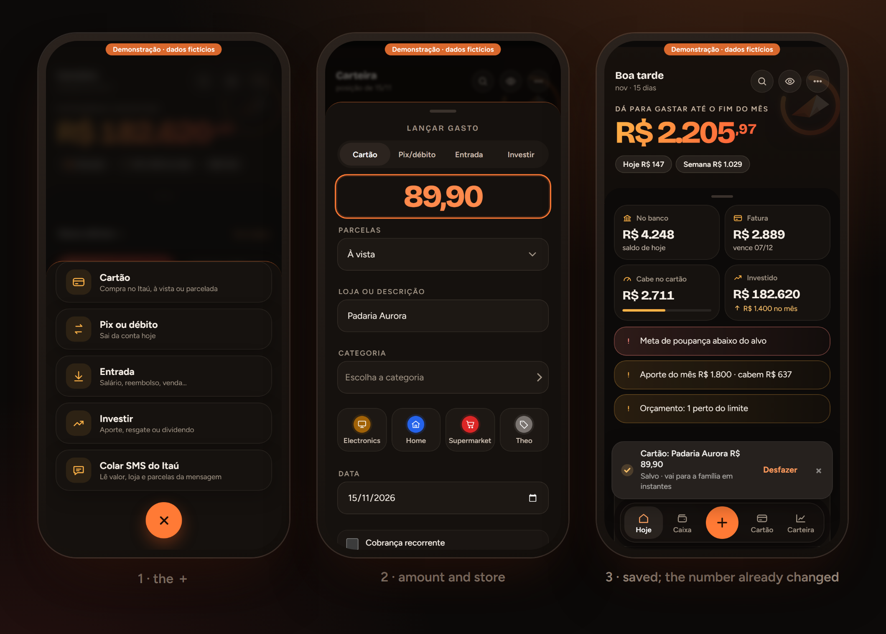
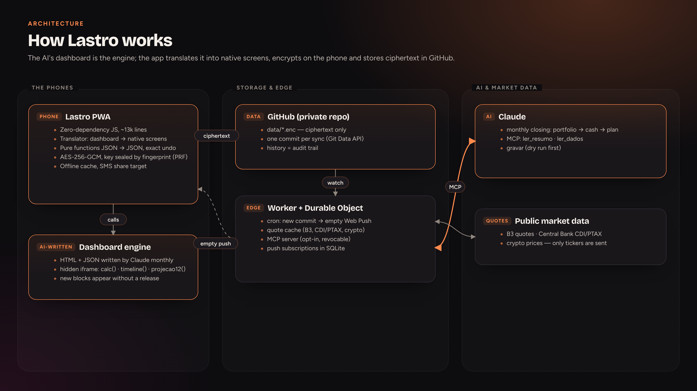
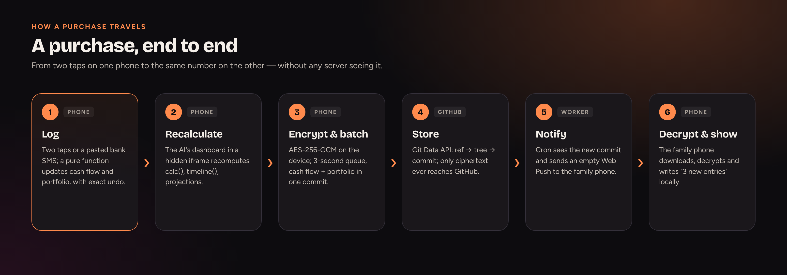

  <a href="https://bebernos.github.io/Lastro-Business/"><b>▶ Live demo</b></a> ·
  <a href="README.pt-BR.md">Leia em português</a> ·
  <a href="docs/architecture.md">Architecture</a> ·
  <a href="SECURITY.md">Security</a> ·
  <a href="docs/case-study.md">Case study</a>

# Lastro

**Lastro is a mobile-first personal finance app (PWA) that puts a family's cash flow, credit card and investment portfolio
in one place — with an AI analyst (Claude) doing the heavy thinking and end-to-end encryption protecting every number.**

It was built for a real family and has been used every day since October 2026: the owner logs card purchases from bank
SMS in two taps, the rest of the family follows everything on their own phones, and once a month the AI closes the books, rebalances
the plan and writes the analyses.

**At a glance:** v10.0 (70 releases in the changelog) · used daily since Oct 2026 · ~14k lines, 0 dependencies · AES-256-GCM end to end · ≈260 regression + 62 end-to-end checks

> The live demo runs with a **fictitious family** (Marina, Rafael, Theo and Mia the cat) generated on the fly, with dates
> that always move with today's calendar. Nothing leaves your browser.

## What it does

 <i>A purchase goes in and the "can still spend" number updates immediately — then syncs, encrypted, to the family.</i>

**In detail**
- **Daily cash flow** — what is left to spend this month, the bills calendar, "paid / to receive" with one tap, and a 12-month
  projection that shows which months will be tight before they arrive.
- **Credit card** — every purchase, installment and subscription; budgets per category with alerts at 80% and 100%; a real
  Excel export of the bill; purchases pasted straight from the bank's SMS (several at once).
- **Investments** — portfolio by asset and class, today's estimate from live public quotes, dividends, goals, an allocation
  plan, a liquidity ladder and a fixed-income switch simulator.
- **Two phones, one truth** — the owner publishes, the family phone gets a push ("3 new entries") and decrypts locally.

## How it works

Lastro is built around one unusual idea — **the AI's monthly dashboard is the calculation engine** — and one hard rule:
**no server may see financial data**. Everything else follows from those two.

**On the device** — ~14,000 lines of plain JavaScript, no framework. Every financial action is a pure function `JSON → JSON` (log a purchase, mark paid, invest, redeem) that keeps the totals the dashboard checks, leaves an audit trail and stores the encrypted previous state for exact undo.

**The dashboard engine** — Each month Claude produces a self-contained HTML dashboard (code + JSON data). Lastro loads it in a hidden iframe and calls its functions (`calc()`, `timeline()`, `projecao12()`…); a translator turns every block into native screens, so a block the AI invents next month appears without a release.

**Encryption** — Data is encrypted on the phone with AES-256-GCM (key from PBKDF2-SHA256, 600k iterations); on the owner's phone the key is sealed by the fingerprint through the WebAuthn PRF extension. GitHub and Cloudflare only ever see ciphertext; push notifications are empty.

**Storage & edge** — A private GitHub repository is the database: cash flow and portfolio are published together in one commit through the Git Data API, batched in a 3-second queue. A Cloudflare Worker with a Durable Object watches the published files, fans out push notifications, caches public market quotes and hosts the MCP server.

**The AI loop** — Monthly closing is a guided three-step ritual (portfolio → cash flow → plan). Day to day, Claude reads a summary or whole fields and writes analyses and plans through the MCP connector — with a dry run first and the user's go-ahead.

### The flow

### Design decisions

| Decision | Why |
|---|---|
| **The dashboard is the engine** | One source of truth for the math; the app never disagrees with the AI. |
| **GitHub as an encrypted database** | Free, versioned and auditable; one commit per sync. |
| **Fingerprint-sealed key (WebAuthn PRF)** | Nothing readable on servers — or on the device. |
| **Empty push notifications** | The push service never sees content; the phone decrypts and writes the text. |
| **One design system, written down** | "Meia-noite": night blue with coral for attention, four tabs (Today · Month · Net worth · Plan), one answer per screen, a drawer with the why behind every number — no green, dark only. See [DESIGN.md](DESIGN.md). |

Deep dive: [docs/architecture.md](docs/architecture.md).

## Security

Financial data is encrypted on the phone (AES-256-GCM, key from PBKDF2-SHA256 with 600k iterations) before it ever leaves
it; GitHub and Cloudflare only see ciphertext. On the owner's phone the key is sealed by the fingerprint through
the WebAuthn PRF extension, so nothing readable is stored on the device. Details and the one opt-in exception (the AI
connector) in [SECURITY.md](SECURITY.md).

## Engineering highlights

- **Zero dependencies.** ~14,000 lines of plain JavaScript (ES modules), no framework, no build step — including a
  hand-written `.xlsx` writer, SVG charts and a Web Push (VAPID/ES256) sender.
- **Serverless on free tiers.** Static app + a Cloudflare Worker with a Durable Object (SQLite) for push subscriptions,
  a quote cache and the MCP server. GitHub is the database (encrypted files, one commit per sync).
- **Tested like a product.** A Playwright regression suite (≈260 checks), an end-to-end suite (62 checks: owner logs,
  publishes, the family phone receives, both match) and 30+ unit test files — run against real data shapes before every
  release.
- **Pure functions for every financial operation** (`JSON → JSON`), so undo is exact and each change is auditable.
- **Accessibility and motion care**: contrast ≥ 4.5:1 in both themes, `prefers-reduced-motion`, screen-reader labels.
- **Offline-first PWA**: service worker cache, share target (receive files and SMS text), app shortcuts.

 <i>The same app on a desktop: a side bar with "Lançar" and one centred reading column.</i>

## Tech stack

JavaScript (ES2023, no framework) · HTML/CSS · Service Worker · Web Crypto (AES-GCM, PBKDF2, HKDF) · WebAuthn PRF ·
Web Push (VAPID) · IndexedDB · Cloudflare Workers + Durable Objects · GitHub API (Git Data) · Model Context Protocol (MCP) ·
Claude · Playwright · Node.js

## Read more

- [Case study](docs/case-study.md) — the problem, the decisions and what came out of them.
- [Architecture](docs/architecture.md) — data flow, the dashboard-as-engine pattern, sync and the MCP connector.
- [Security](SECURITY.md) — threat model and how each layer works.

## The suite

| | |
|---|---|
| [**Lastro**](https://github.com/BeBernos/Lastro-Business) | Family finance hub — cash flow, credit card and investments, encrypted end to end |
| [**Mesa**](https://github.com/BeBernos/Mesa-Business) | Family nutrition plan, planned by AI |
| [**Pulse**](https://github.com/BeBernos/Pulse-Business) | Strength training with AI-built programs and 2D/3D exercise animations |
| [**Cesta**](https://github.com/BeBernos/Cesta-Business) | Grocery price research, shopping route and receipt audit |

## About

Designed and built by **Bruno Bernos** — product, UX and engineering — working with Claude Code as a pair programmer.
Contact: [github.com/BeBernos](https://github.com/BeBernos).

## License

Copyright © 2026 Bruno Bernos. **All rights reserved.** The source is published for evaluation only; no permission is
granted to use, copy, modify or distribute it. See [LICENSE](LICENSE). For commercial interest, get in touch.
