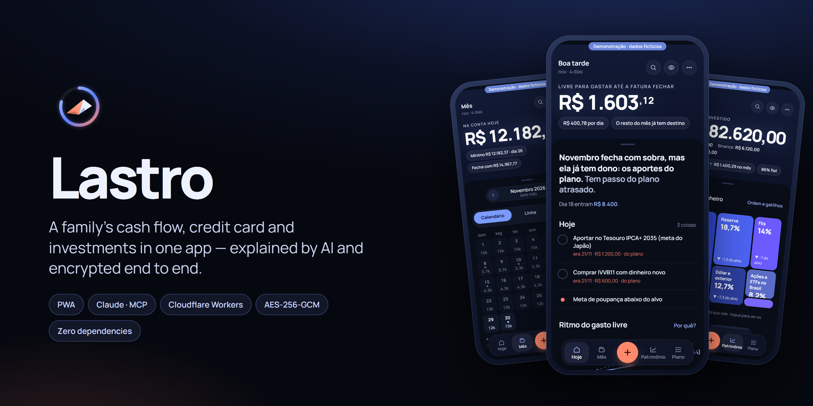
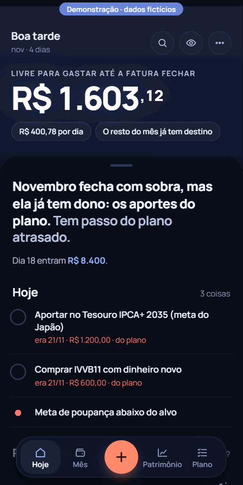
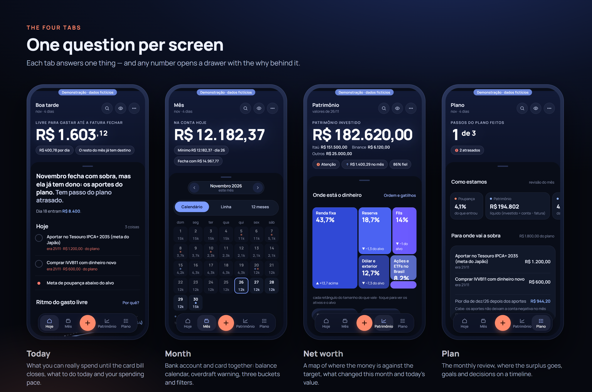
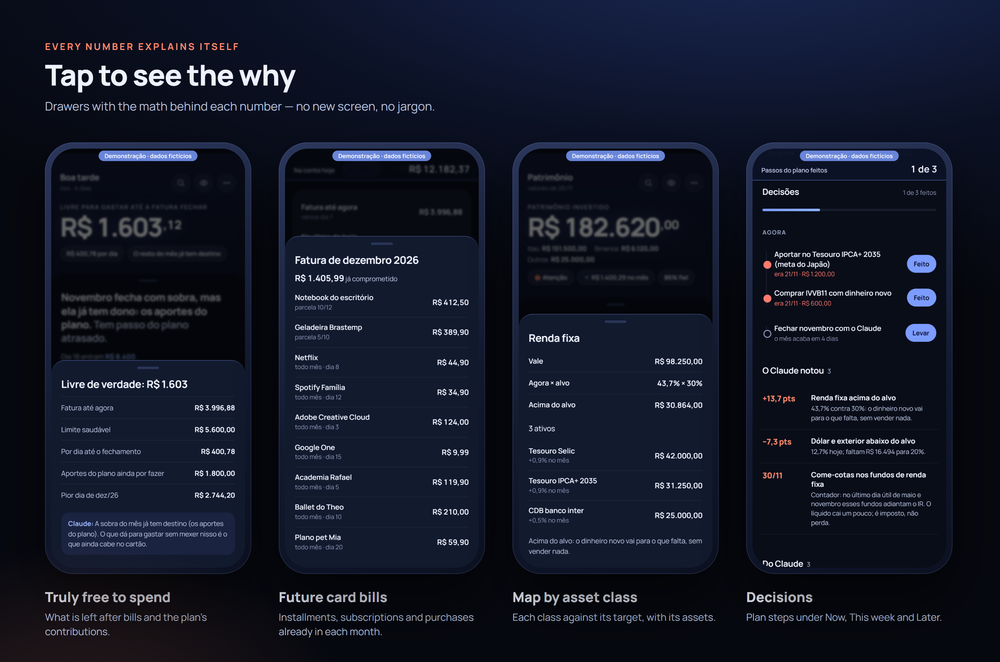
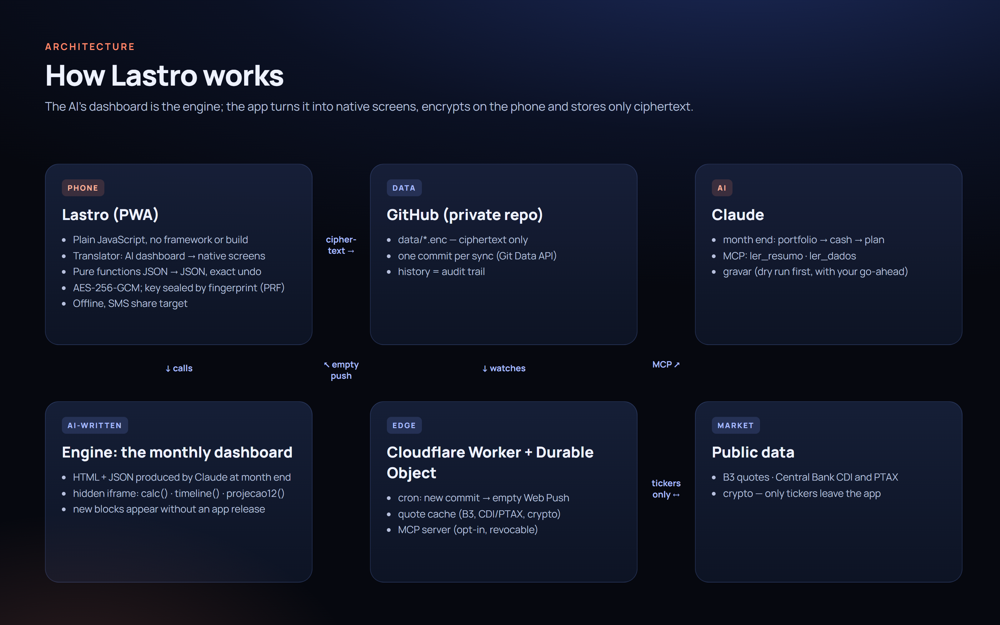
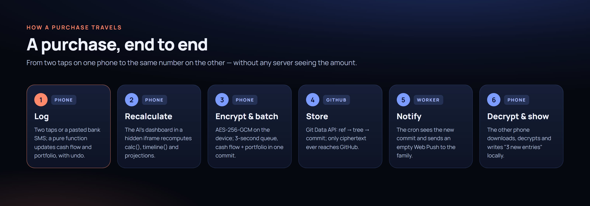
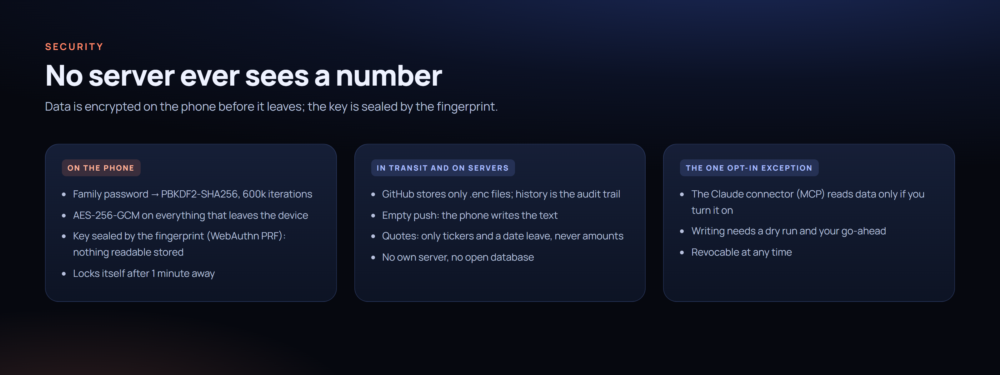
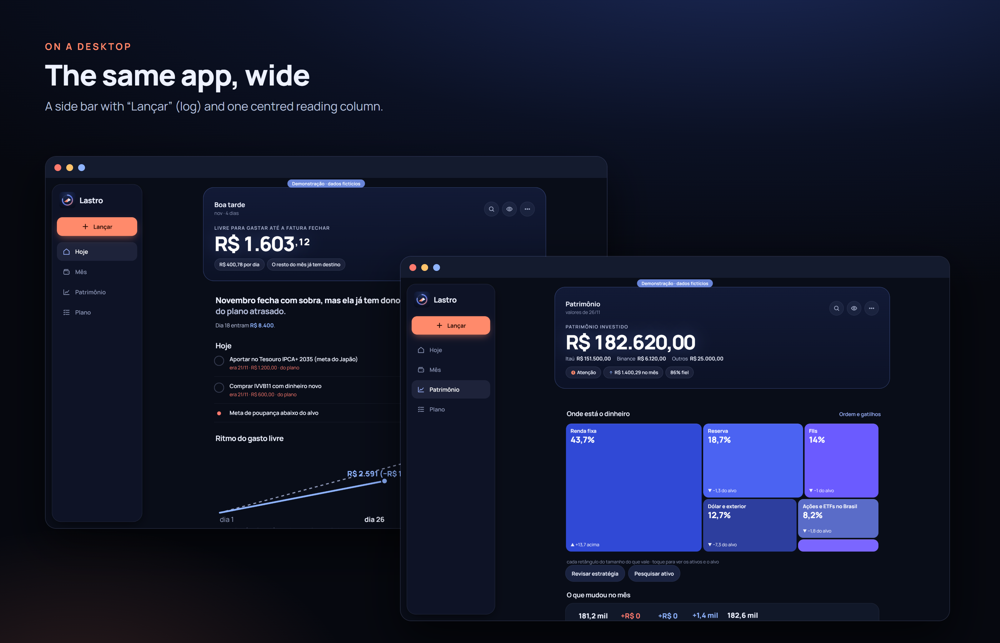

  <a href="https://bebernos.github.io/Lastro-Business/"><b>▶ Try the live demo</b></a> ·
  <a href="README.pt-BR.md">Leia em português</a> ·
  <a href="docs/architecture.md">Architecture</a> ·
  <a href="SECURITY.md">Security</a> ·
  <a href="docs/case-study.md">Case study</a>

  
  
  
  
  

# Lastro

**Lastro is a mobile-first personal finance app (PWA) that puts a family's bank account, credit card and investment portfolio
in one place. An AI analyst (Claude) does the heavy thinking once a month; end-to-end encryption means no server ever sees a
number.**

It was built for a real family and has been used every day since October 2026. The owner logs card purchases in two taps
(or by pasting the bank's SMS), the rest of the family follows everything on their own phones, and at the end of the month
the AI closes the books, checks the investment plan and writes the analyses.

**At a glance**
- **83 releases** with release notes, used daily since Oct 2026
- **~18,000 lines, zero dependencies** — plain JavaScript, no framework, no build step
- **257 regression + 62 end-to-end checks** (Playwright) and 59 unit-test files, run before every release
- **AES-256-GCM on the phone**, key sealed by the fingerprint (WebAuthn PRF) — GitHub and Cloudflare only see ciphertext

> The live demo runs with a **fictitious family** (Marina, Rafael, Theo and Mia the cat) generated on the fly, with dates
> that always follow today's calendar. Nothing leaves your browser.

## See it in action

<table>
  <tr>
    <td align="center" width="50%"></td>
    <td align="center" width="50%"></td>
  </tr>
  <tr>
    <td align="center"><b>The four tabs</b> Today → the why behind the number → Month (calendar, line, 12 months) → Net worth (map by asset class) → Plan (decisions)</td>
    <td align="center"><b>Logging a purchase</b> ＋ → Card → amount and category → saved. "Free to spend" drops from R$ 1,603 to R$ 1,548 on the spot, then syncs, encrypted, to the family.</td>
  </tr>
</table>

## What it does

- **Today** — a morning briefing. The big number is what is *truly* free to spend until the card bill closes (after bills
  and the plan's investments are set aside), a one-line read of the month, up to three things to do today, the pace of
  discretionary spending against the line that ends at the limit, and the next days.
- **Month** — bank account and card together. A balance calendar that flags overdraft days before they happen (and suggests
  moving the card's due date when that is the cause), a daily line and 12 months ahead, the month in three buckets (fixed,
  free, surplus), and filters for upcoming bills (one-tap *paid*), the card bill, categories with budgets that warn early,
  and every account entry.
- **Net worth** — a treemap of where the money is against the target allocation, what changed this month as a waterfall
  (redemptions, contributions, market), what the portfolio is worth *today* from live public quotes, the projection with
  milestones you can toggle, dividends, goals and the twice-a-year fund tax (*come-cotas*) reminder.
- **Plan** — the monthly review (savings rate, net worth, months of reserve, card usage, spending pace), where the surplus
  goes and whether it fits next month's cash, goals as "pots", plan steps on a timeline (Now · This week · Later) and what
  the AI noticed.
- **Logging** — two taps from the ＋, or paste one or several bank SMS at once (installments, refunds and duplicates are
  recognised). Anything that repeats asks *from when* the change applies; everything can be undone.
- **Two phones, one truth** — the owner publishes; the family phone gets an empty push ("3 new entries") and decrypts locally.

### Every number explains itself

Tap any number and a drawer opens with the math behind it — no new screen, no jargon.

## How it works

Lastro is built around one unusual idea — **the AI's monthly dashboard is the calculation engine** — and one hard rule:
**no server may see financial data**. Everything else follows from those two.

- **On the device** — plain JavaScript (ES modules), no framework. Every financial action is a pure function `JSON → JSON`
  (log a purchase, mark as paid, invest, redeem) that keeps the totals the engine checks, leaves an audit trail and stores
  the encrypted previous state for an exact undo.
- **The engine** — each month Claude produces a self-contained HTML dashboard (code + JSON). Lastro loads it in a hidden
  iframe and calls its functions (`calc()`, `timeline()`, `projecao12()`…); a translator turns its blocks into native
  screens, so a block the AI invents next month shows up without an app release.
- **Encryption** — data is encrypted on the phone with AES-256-GCM (key from PBKDF2-SHA256, 600k iterations); on the owner's
  phone the key is sealed by the fingerprint through the WebAuthn PRF extension.
- **Storage & edge** — a private GitHub repository is the database: cash flow and portfolio go out together in one commit
  through the Git Data API, batched in a 3-second queue. A Cloudflare Worker with a Durable Object watches the published
  files, sends empty push notifications, caches public market quotes and hosts the MCP server.
- **The AI loop** — month-end closing is a guided three-step ritual (portfolio → cash flow → plan). Day to day, Claude reads
  a summary or whole fields and writes analyses and plans through the MCP connector — always with a dry run first and the
  user's go-ahead.

### The flow

### Design decisions

| Decision | Why |
|---|---|
| **The dashboard is the engine** | One source of truth for the math; the app never disagrees with the AI. |
| **GitHub as an encrypted database** | Free, versioned and auditable; one commit per sync. |
| **Fingerprint-sealed key (WebAuthn PRF)** | Nothing readable on servers — or stored on the device. |
| **Empty push notifications** | The push service never sees content; the phone decrypts and writes the text. |
| **One question per screen** | Four tabs, each answering one thing; every number opens a drawer with the why. |
| **One design system, written down** | "Meia-noite": night blue, coral only for attention, Manrope, dark only, no green. See [DESIGN.md](DESIGN.md). |
| **The user is always in control** | Past, present and future are editable; unusual things get a warning, never a lock. |

Deep dive: [docs/architecture.md](docs/architecture.md).

## Security

Financial data is encrypted on the phone before it ever leaves it; GitHub and Cloudflare only see ciphertext, and push
notifications carry no content. On the owner's phone the key is sealed by the fingerprint, so nothing readable is stored on
the device, and the app locks itself after one minute away. The one opt-in exception — the AI connector — and the full
threat model are in [SECURITY.md](SECURITY.md).

## Engineering highlights

- **Zero dependencies.** ~18,000 lines of plain JavaScript, CSS and HTML — including a hand-written `.xlsx` writer, SVG
  charts, a treemap and a Web Push (VAPID/ES256) sender.
- **Serverless on free tiers.** A static app plus one Cloudflare Worker with a Durable Object (SQLite) for push
  subscriptions, the quote cache and the MCP server. GitHub is the database.
- **Tested like a product.** 257 Playwright regression checks, 62 end-to-end checks (the owner logs and publishes, the
  family phone receives, both match), 59 unit-test files, plus a pixel-by-pixel before/after screenshot comparison for
  visual refactors — all run against real data shapes before every release.
- **Pure functions for every financial operation** (`JSON → JSON`), so undo is exact and every change is auditable.
- **Offline-first PWA** — service worker cache, share target (receives files and SMS text), app shortcuts, installable on
  Android and desktop.
- **Accessibility and motion care** — text ≥ 12 px, contrast ≥ 4.5:1, `prefers-reduced-motion`, labels on icon buttons.

## Tech stack

JavaScript (ES2023, no framework) · HTML/CSS · Service Worker · Web Crypto (AES-GCM, PBKDF2, HKDF) · WebAuthn PRF ·
Web Push (VAPID) · IndexedDB · Cloudflare Workers + Durable Objects · GitHub API (Git Data) · Model Context Protocol (MCP) ·
Claude · Playwright · Node.js

## Read more

- [Case study](docs/case-study.md) — the problem, the decisions and what came out of them.
- [Architecture](docs/architecture.md) — data flow, the dashboard-as-engine pattern, sync and the MCP connector.
- [Security](SECURITY.md) — threat model and how each layer works.
- [Design](DESIGN.md) — the design system.

## The suite

| | |
|---|---|
| [**Lastro**](https://github.com/BeBernos/Lastro-Business) | Family finance hub — cash flow, credit card and investments, encrypted end to end |
| [**Mesa**](https://github.com/BeBernos/Mesa-Business) | Family nutrition plan, planned by AI |
| [**Pulse**](https://github.com/BeBernos/Pulse-Business) | Strength training with AI-built programs and 2D/3D exercise animations |
| [**Cesta**](https://github.com/BeBernos/Cesta-Business) | Grocery price research, shopping route and receipt audit |

## About

Designed and built by **Bruno Bernos** — product, UX and engineering — working with Claude Code as a pair programmer.
Contact: [github.com/BeBernos](https://github.com/BeBernos).

## License

Copyright © 2026 Bruno Bernos. **All rights reserved.** The source is published for evaluation only; no permission is
granted to use, copy, modify or distribute it. See [LICENSE](LICENSE). For commercial interest, get in touch.
