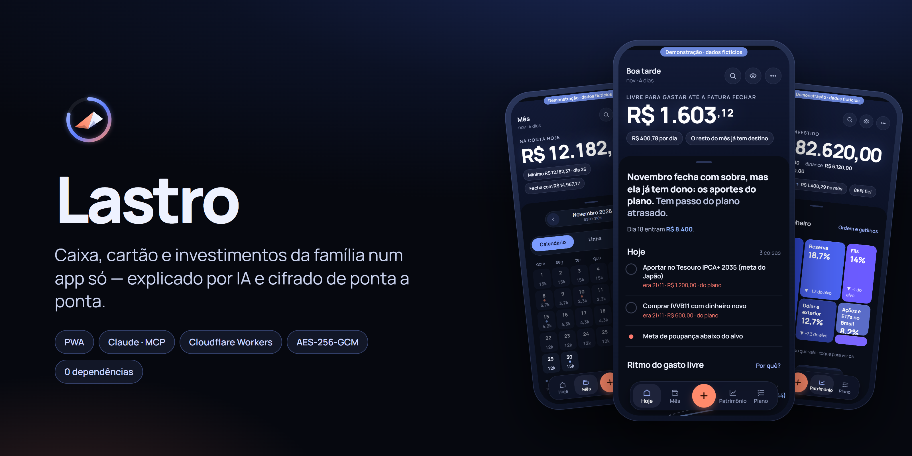
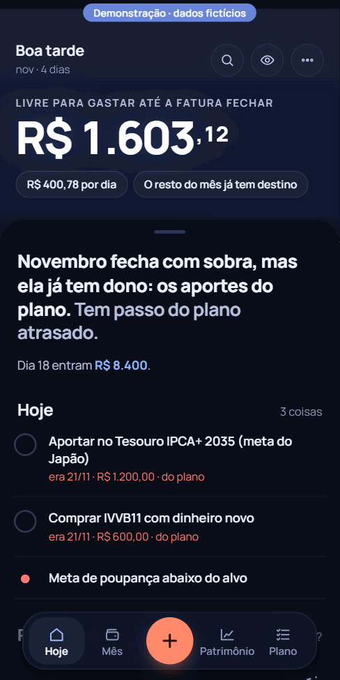
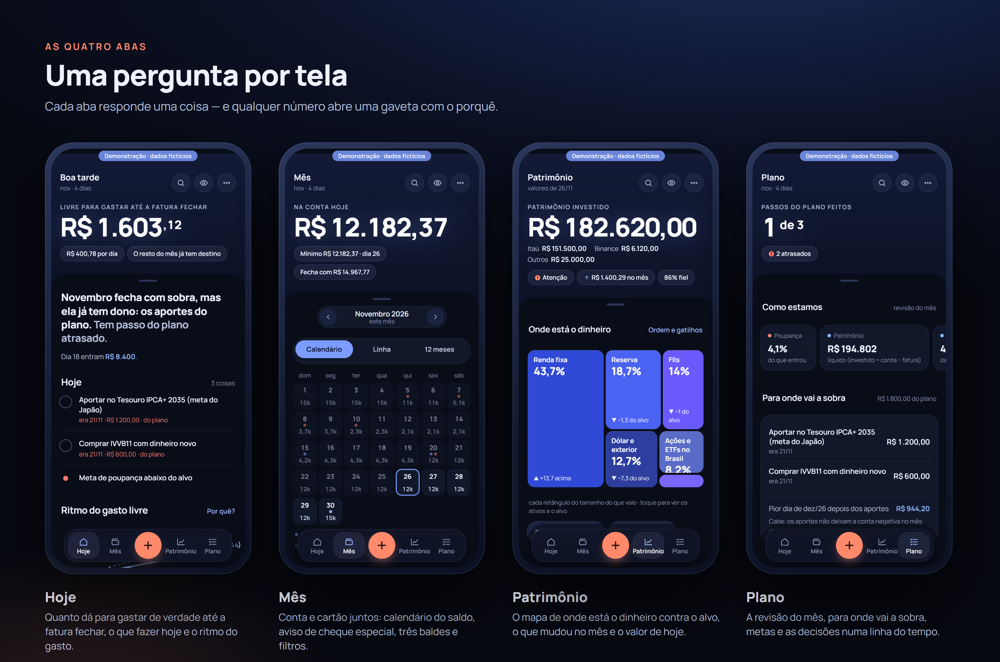
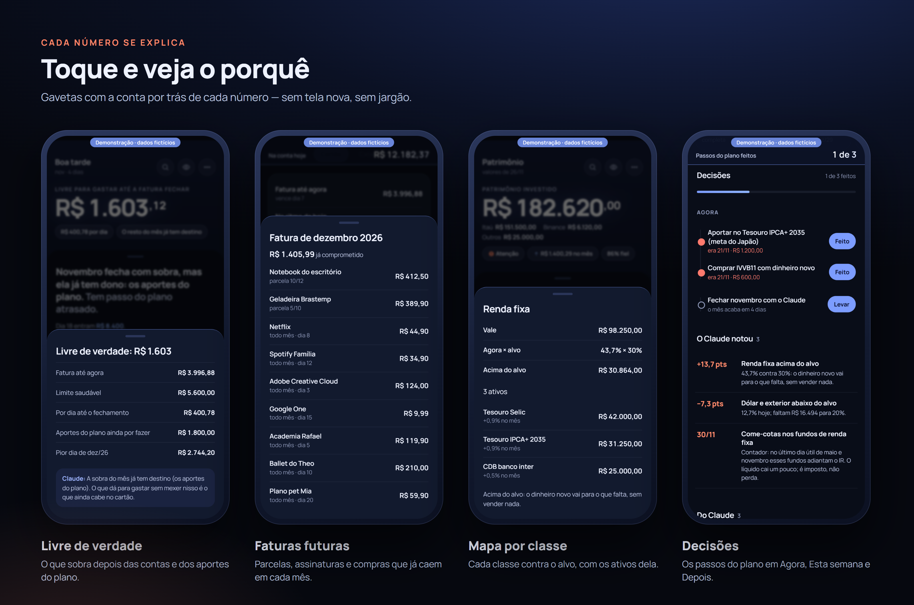
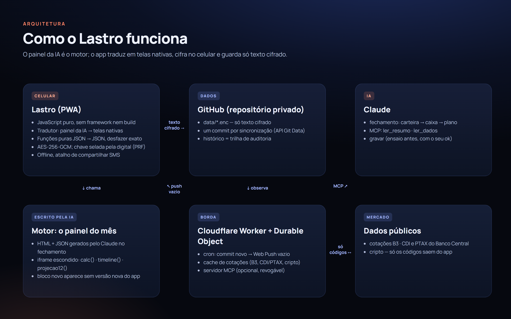
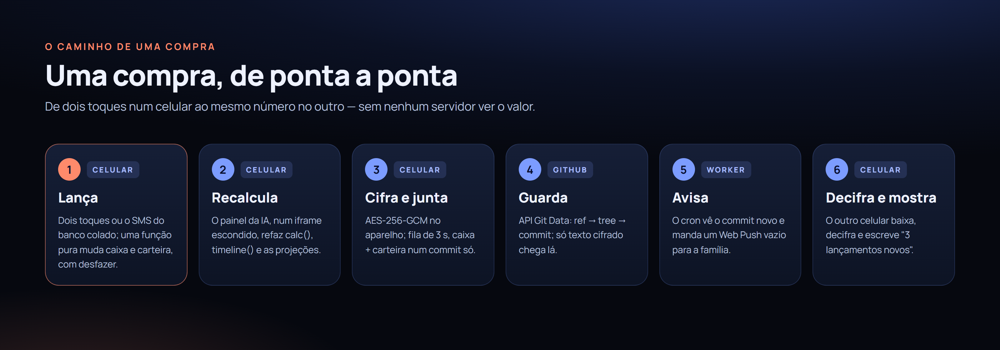
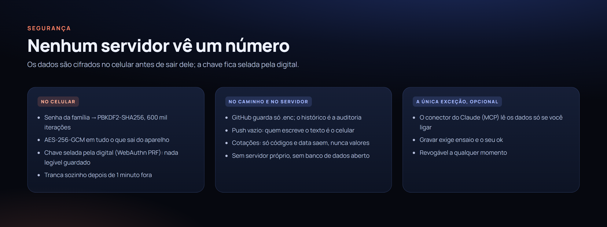
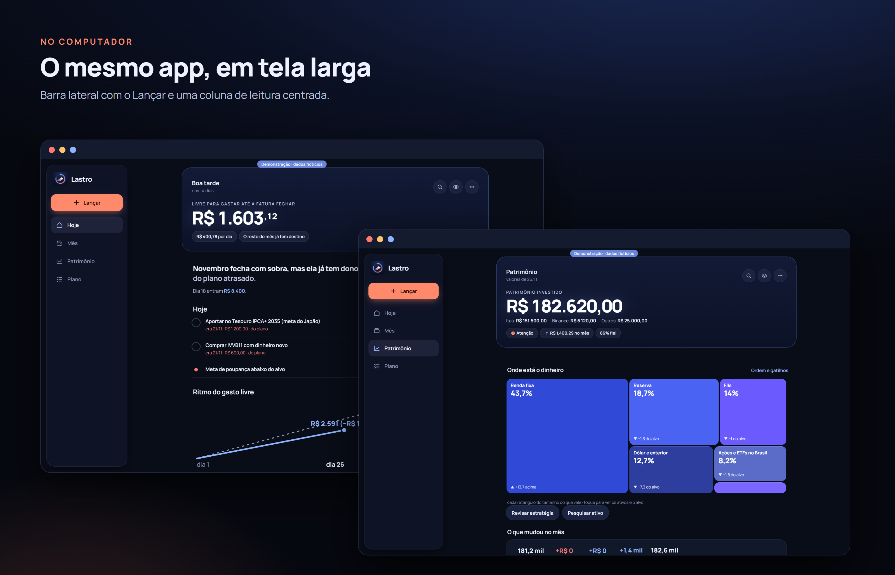

  <a href="https://bebernos.github.io/Lastro-Business/"><b>▶ Experimente a demonstração</b></a> ·
  <a href="README.md">Read in English</a> ·
  <a href="docs/architecture.pt-BR.md">Arquitetura</a> ·
  <a href="SECURITY.md">Segurança</a> ·
  <a href="docs/case-study.pt-BR.md">Estudo de caso</a>

  
  
  
  
  

# Lastro

**O Lastro é um app de finanças pessoais (PWA, feito para o celular) que junta num lugar só a conta, o cartão de crédito
e a carteira de investimentos de uma família. Um analista de IA (o Claude) faz a parte pesada uma vez por mês; a
criptografia de ponta a ponta garante que nenhum servidor veja um número.**

Foi feito para uma família de verdade e é usado todo dia desde outubro de 2026. Quem cuida das contas lança as compras do
cartão em dois toques (ou colando o SMS do banco), o resto da família acompanha tudo no próprio celular e, no fim do mês, a
IA fecha as contas, confere o plano de investimentos e escreve as análises.

**Em números**
- **83 versões** com notas de lançamento, uso diário desde out/2026
- **~18 mil linhas, zero dependências** — JavaScript puro, sem framework e sem etapa de build
- **257 verificações de regressão + 62 de ponta a ponta** (Playwright) e 59 arquivos de teste de unidade, antes de cada versão
- **AES-256-GCM no celular**, chave selada pela digital (WebAuthn PRF) — o GitHub e o Cloudflare só veem texto cifrado

> A demonstração roda com uma **família fictícia** (Marina, Rafael, Theo e a gata Mia), gerada na hora, com datas que
> acompanham o calendário de hoje. Nada sai do seu navegador.

## Veja funcionando

<table>
  <tr>
    <td align="center" width="50%"></td>
    <td align="center" width="50%"></td>
  </tr>
  <tr>
    <td align="center"><b>As quatro abas</b> Hoje → o porquê do número → Mês (calendário, linha, 12 meses) → Patrimônio (mapa por classe) → Plano (decisões)</td>
    <td align="center"><b>Lançar uma compra</b> ＋ → Cartão → valor e categoria → salvo. O "livre para gastar" cai de R$ 1.603 para R$ 1.548 na hora e depois vai, cifrado, para a família.</td>
  </tr>
</table>

## O que ele faz

- **Hoje** — um resumo do dia. O número grande é o que está *de verdade* livre para gastar até a fatura fechar (já
  separadas as contas e os aportes do plano), uma frase sobre o mês, até três coisas para fazer hoje, o ritmo do gasto livre
  contra a linha que fecha no limite e os próximos dias.
- **Mês** — conta e cartão juntos. Um calendário do saldo que avisa os dias de cheque especial antes de acontecerem (e
  sugere mudar o vencimento da fatura quando é ele a causa), a linha do mês e os próximos 12 meses, o mês em três baldes
  (fixo, livre, sobra) e filtros para as próximas contas (*paguei* num toque), a fatura, as categorias com orçamento que
  avisa antes e todas as contas do mês.
- **Patrimônio** — um mapa de onde está o dinheiro contra a alocação-alvo, o que mudou no mês em degraus (resgates, aportes,
  mercado), quanto a carteira vale *hoje* pelas cotações públicas, a projeção com marcos que você liga e desliga,
  dividendos, metas e o aviso do come-cotas.
- **Plano** — a revisão do mês (poupança, patrimônio líquido, reserva em meses, uso do cartão, ritmo do gasto), para onde
  vai a sobra e se ela cabe no caixa do mês seguinte, metas como "potes", os passos do plano numa linha do tempo (Agora ·
  Esta semana · Depois) e o que a IA notou.
- **Lançar** — dois toques no ＋, ou cole um ou vários SMS do banco de uma vez (parcelado, estorno e repetido são
  reconhecidos). O que se repete pergunta *de quando vale* a mudança; tudo tem desfazer.
- **Dois celulares, uma verdade** — quem cuida publica; o celular da família recebe um aviso vazio ("3 lançamentos novos") e
  decifra no próprio aparelho.

### Cada número se explica

Toque em qualquer número e abre uma gaveta com a conta por trás dele — sem tela nova, sem jargão.

## Como funciona

O Lastro gira em torno de uma ideia pouco comum — **o painel mensal da IA é o motor de cálculo** — e de uma regra dura:
**nenhum servidor pode ver dado financeiro**. Todo o resto sai dessas duas.

- **No aparelho** — JavaScript puro (módulos ES), sem framework. Cada ação financeira é uma função pura `JSON → JSON`
  (lançar uma compra, marcar como pago, investir, resgatar) que mantém os totais que o motor confere, deixa rastro e guarda
  o estado anterior cifrado para um desfazer exato.
- **O motor** — todo mês o Claude gera um painel HTML completo (código + JSON). O Lastro abre esse painel num iframe
  escondido e chama as funções dele (`calc()`, `timeline()`, `projecao12()`…); um tradutor transforma os blocos em telas
  nativas, então um bloco que a IA inventar no mês seguinte aparece sem versão nova do app.
- **Criptografia** — os dados são cifrados no celular com AES-256-GCM (chave do PBKDF2-SHA256, 600 mil iterações); no
  celular de quem cuida, a chave fica selada pela digital pela extensão PRF do WebAuthn.
- **Armazenamento e borda** — um repositório privado no GitHub é o banco de dados: caixa e carteira saem juntos num commit
  só pela API Git Data, numa fila de 3 segundos. Um Worker do Cloudflare com um Durable Object observa os arquivos
  publicados, manda os avisos vazios, guarda as cotações públicas e hospeda o servidor MCP.
- **O ciclo com a IA** — o fechamento do mês é um ritual guiado em três etapas (carteira → caixa → plano). No dia a dia, o
  Claude lê um resumo ou campos inteiros e grava análises e planos pelo conector MCP — sempre com um ensaio antes e o ok de
  quem usa.

### O caminho de uma compra

### Decisões de projeto

| Decisão | Por quê |
|---|---|
| **O painel é o motor** | Uma fonte só para as contas; o app nunca discorda da IA. |
| **GitHub como banco de dados cifrado** | Grátis, versionado e auditável; um commit por sincronização. |
| **Chave selada pela digital (WebAuthn PRF)** | Nada legível nos servidores — nem guardado no aparelho. |
| **Avisos vazios** | O serviço de push nunca vê conteúdo; o celular decifra e escreve o texto. |
| **Uma pergunta por tela** | Quatro abas, cada uma responde uma coisa; todo número abre uma gaveta com o porquê. |
| **Um sistema visual, escrito** | "Meia-noite": azul-noite, coral só para atenção, fonte Manrope, escuro sempre, sem verde. Ver [DESIGN.md](DESIGN.md). |
| **Quem usa manda** | Passado, presente e futuro editáveis; o incomum ganha um aviso, nunca uma trava. |

Em detalhe: [docs/architecture.pt-BR.md](docs/architecture.pt-BR.md).

## Segurança

Os dados financeiros são cifrados no celular antes de sair dele; o GitHub e o Cloudflare só veem texto cifrado e os avisos
não levam conteúdo. No celular de quem cuida, a chave fica selada pela digital — nada legível fica guardado no aparelho — e
o app tranca sozinho depois de um minuto fora. A única exceção, opcional — o conector da IA — e o modelo de ameaça
completo estão em [SECURITY.md](SECURITY.md).

## Destaques de engenharia

- **Zero dependências.** ~18 mil linhas de JavaScript, CSS e HTML puros — incluindo um gerador de `.xlsx` feito à mão,
  gráficos em SVG, um treemap e o envio de Web Push (VAPID/ES256).
- **Sem servidor, no plano grátis.** Um app estático e um Worker do Cloudflare com um Durable Object (SQLite) para as
  inscrições de aviso, o cache de cotações e o servidor MCP. O GitHub é o banco de dados.
- **Testado como produto.** 257 verificações de regressão em Playwright, 62 de ponta a ponta (quem cuida lança e publica,
  o celular da família recebe, os dois batem), 59 arquivos de teste de unidade e uma comparação de telas pixel a pixel,
  antes × depois, nas mudanças de visual — tudo com dados no formato real antes de cada versão.
- **Funções puras para toda operação financeira** (`JSON → JSON`): o desfazer é exato e toda mudança é auditável.
- **PWA que funciona offline** — cache no service worker, compartilhar para o app (arquivos e texto de SMS), atalhos,
  instalável no Android e no computador.
- **Acessibilidade e cuidado com movimento** — letras ≥ 12 px, contraste ≥ 4,5:1, `prefers-reduced-motion`, rótulos nos
  botões de ícone.

## Tecnologias

JavaScript (ES2023, sem framework) · HTML/CSS · Service Worker · Web Crypto (AES-GCM, PBKDF2, HKDF) · WebAuthn PRF ·
Web Push (VAPID) · IndexedDB · Cloudflare Workers + Durable Objects · API do GitHub (Git Data) · Model Context Protocol (MCP) ·
Claude · Playwright · Node.js

## Para ler mais

- [Estudo de caso](docs/case-study.pt-BR.md) — o problema, as decisões e o que saiu delas.
- [Arquitetura](docs/architecture.pt-BR.md) — fluxo dos dados, o painel como motor, sincronização e o conector MCP.
- [Segurança](SECURITY.md) — modelo de ameaça e como cada camada funciona.
- [Design](DESIGN.md) — o sistema visual.

## O conjunto

| | |
|---|---|
| [**Lastro**](https://github.com/BeBernos/Lastro-Business) | Finanças da família — caixa, cartão e investimentos, com criptografia de ponta a ponta |
| [**Mesa**](https://github.com/BeBernos/Mesa-Business) | Plano alimentar da família, montado por IA |
| [**Pulse**](https://github.com/BeBernos/Pulse-Business) | Treino de força com programas montados por IA e animações 2D/3D dos exercícios |
| [**Cesta**](https://github.com/BeBernos/Cesta-Business) | Pesquisa de preços de mercado, rota de compra e conferência da nota |

## Sobre

Desenhado e construído por **Bruno Bernos** — produto, UX e engenharia — com o Claude Code como par de programação.
Contato: [github.com/BeBernos](https://github.com/BeBernos).

## Licença

Copyright © 2026 Bruno Bernos. **Todos os direitos reservados.** O código está publicado só para avaliação; não há
permissão para usar, copiar, modificar ou distribuir. Veja [LICENSE](LICENSE). Interesse comercial: entre em contato.
