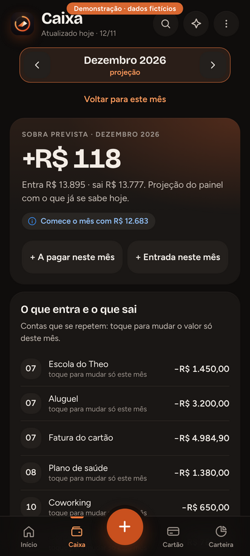
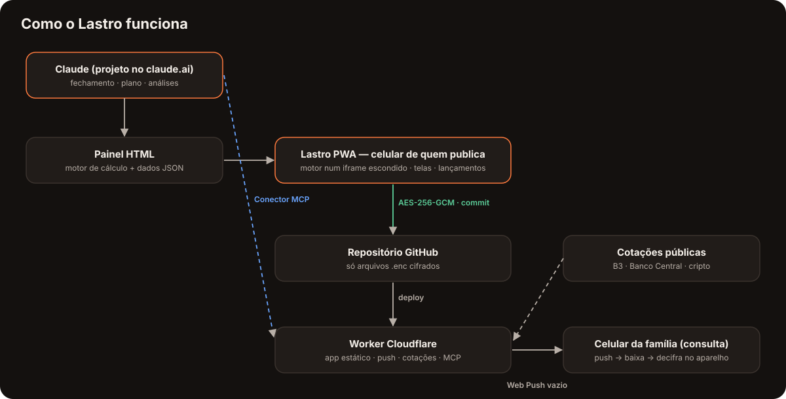
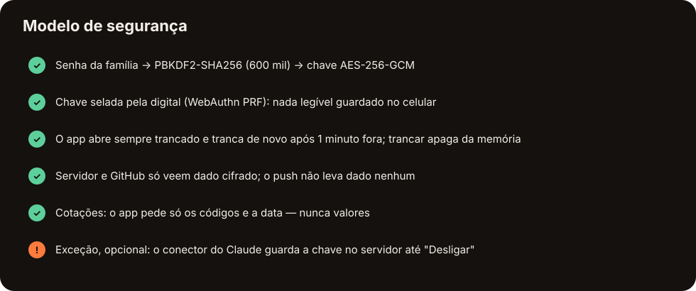

  <a href="https://bebernos.github.io/Lastro-Business/"><b>▶ Demonstração ao vivo</b></a> ·
  <a href="README.md">Read in English</a> ·
  <a href="docs/architecture.pt-BR.md">Arquitetura</a> ·
  <a href="SECURITY.md">Segurança</a> ·
  <a href="docs/case-study.pt-BR.md">Estudo de caso</a>

# Lastro

**O Lastro é um app de finanças pessoais (PWA, feito para o celular) que junta num lugar só o caixa do mês, o cartão de
crédito e a carteira de investimentos de uma família — com um analista de IA (o Claude) fazendo o trabalho pesado de
análise e criptografia de ponta a ponta protegendo cada número.**

Ele foi feito para uma família de verdade e é usado todo dia desde outubro de 2026: quem cuida das contas lança as compras
do cartão a partir do SMS do banco em dois toques, o resto da família acompanha tudo no próprio celular e, uma vez por
mês, a IA fecha o mês, revisa o plano e escreve as análises.

> A demonstração usa uma **família fictícia** (Marina, Rafael, Theo e a gata Mia), gerada na hora, com as datas sempre
> andando junto com o calendário. Nada sai do seu navegador.

## O que ele faz

| | | | |
|:---:|:---:|:---:|:---:|
|  **Quanto ainda dá para gastar?** |  **Linha do tempo do mês** |  **Cartão, item por item** |  **Investimentos e metas** |
|  **Qualquer mês: passado ou projetado** |  **Orçamento por categoria** |  **Análises da IA e nota de saúde** |  **Lançar em dois toques (ou colar o SMS)** |

 
<i>A compra entra e o "dá para gastar" muda na hora — depois sincroniza, cifrado, com a família.</i>

- **Caixa do dia a dia** — quanto ainda cabe no mês, a agenda de contas, "paguei / recebi" com um toque e uma projeção de
  12 meses que mostra antes quais meses vão apertar.
- **Cartão de crédito** — cada compra, parcela e assinatura; orçamento por categoria com aviso em 80% e 100%; planilha da
  fatura em Excel de verdade. As compras podem ser coladas direto do SMS do banco (várias de uma vez).
- **Investimentos** — carteira por ativo e classe, "estimativa de hoje" pelas cotações públicas, dividendos, metas, plano
  de alocação, escada de liquidez (quando cada parte do dinheiro fica disponível) e simulador de troca na renda fixa.
- **Passado e futuro** — escolha qualquer mês: os fechados podem ser corrigidos, os que vêm recebem contas e entradas.
- **Dois celulares, uma verdade só** — quem lança publica, o outro celular recebe a notificação ("3 lançamentos novos") e
  decifra no próprio aparelho.
- **IA onde ela traz julgamento** — fechamento do mês, revisão do plano e análises ficam com o Claude, que lê e grava os
  dados direto por um **conector MCP** (sem baixar nem anexar arquivo).

## Como funciona

O pulo do gato: **o motor de cálculo é um painel HTML escrito pela IA.** Todo mês o Claude gera um painel autossuficiente
(código + dados JSON). O Lastro o carrega num iframe escondido e chama as funções dele (`calc()`, `timeline()`,
`projecao12()`…) — o app nunca refaz a conta: ele **traduz** o painel em telas de app e acrescenta o que o painel não faz:
lançamentos, sincronização, criptografia, notificações, uso sem internet. Quando a IA cria um bloco novo no painel, ele
aparece no app sozinho.

Mais em [docs/architecture.pt-BR.md](docs/architecture.pt-BR.md).

## Segurança

Os dados financeiros são cifrados no celular (AES-256-GCM, chave derivada por PBKDF2-SHA256 com 600 mil iterações) antes
de sair dele; o GitHub e a Cloudflare só veem dado cifrado. No celular de quem publica, a chave é selada pela digital
(extensão PRF do WebAuthn): nada legível fica guardado no aparelho. Detalhes e a única exceção opcional (o conector da IA)
em [SECURITY.md](SECURITY.md).

## Destaques de engenharia

- **Zero dependências.** ~13 mil linhas de JavaScript puro (módulos ES), sem framework e sem etapa de build — incluindo
  um gerador de `.xlsx` próprio, gráficos em SVG e o envio de Web Push (VAPID/ES256).
- **Sem servidor próprio, no plano grátis.** App estático + um Worker da Cloudflare com Durable Object (SQLite) para as
  inscrições de push, o cache de cotações e o servidor MCP. O GitHub é o banco de dados (arquivos cifrados, um commit por
  sincronização).
- **Testado como produto.** Bateria de regressão em Playwright (≈260 verificações), ponta a ponta (62: quem lança publica,
  o celular da família recebe, os dois batem) e mais de 30 arquivos de teste de unidade — rodados com dados no formato real
  antes de cada versão.
- **Funções puras em toda operação financeira** (`JSON → JSON`): o desfazer é exato e cada mudança fica rastreável.
- **Acessibilidade e movimento com cuidado**: contraste ≥ 4,5:1 nos dois temas, `prefers-reduced-motion`, rótulos para
  leitor de tela.
- **PWA que funciona sem internet**: cache no service worker, recebe arquivos e texto de SMS pelo Compartilhar, atalhos no ícone.

 <i>O mesmo app no computador.</i>

## Tecnologias

JavaScript (ES2023, sem framework) · HTML/CSS · Service Worker · Web Crypto (AES-GCM, PBKDF2, HKDF) · WebAuthn PRF ·
Web Push (VAPID) · IndexedDB · Cloudflare Workers + Durable Objects · API do GitHub (Git Data) · Model Context Protocol (MCP) ·
Claude · Playwright · Node.js

## Para ler mais

- [Estudo de caso](docs/case-study.pt-BR.md) — o problema, as decisões e o que saiu delas.
- [Arquitetura](docs/architecture.pt-BR.md) — fluxo dos dados, o painel como motor, sincronização e o conector MCP.
- [Segurança](SECURITY.md) — modelo de ameaça e como cada camada funciona.

## Sobre

Desenhado e construído por **Bruno Bernos** — produto, UX e engenharia — com o Claude Code como par de programação.
Contato: [github.com/BeBernos](https://github.com/BeBernos).

## Licença

Copyright © 2026 Bruno Bernos. **Todos os direitos reservados.** O código está publicado só para avaliação; não há
permissão para usar, copiar, modificar ou distribuir. Veja [LICENSE](LICENSE). Interesse comercial: entre em contato.
