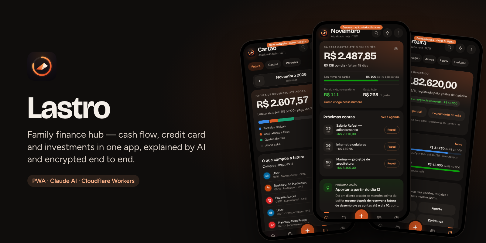
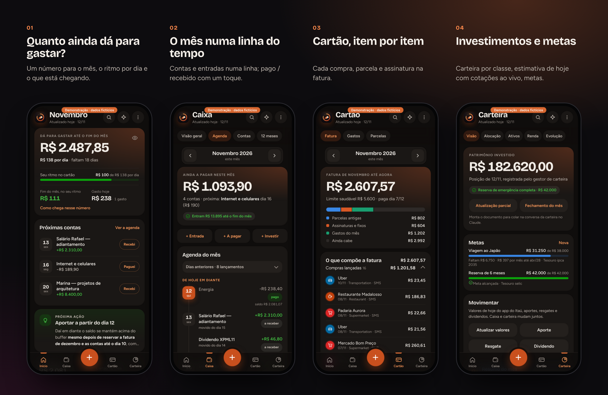
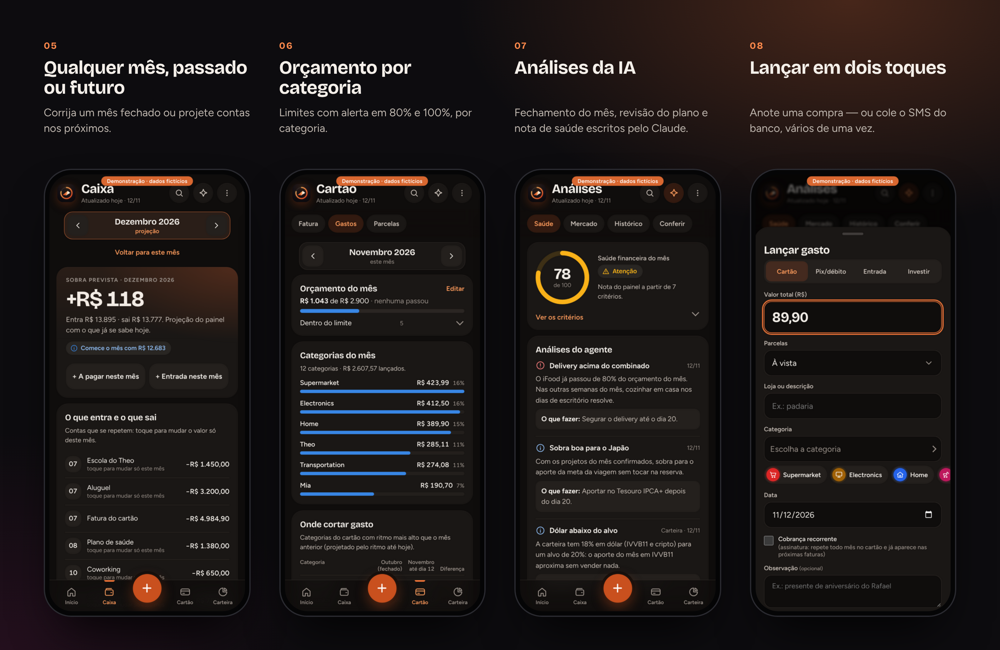
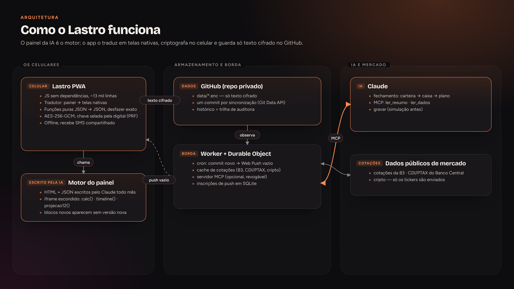
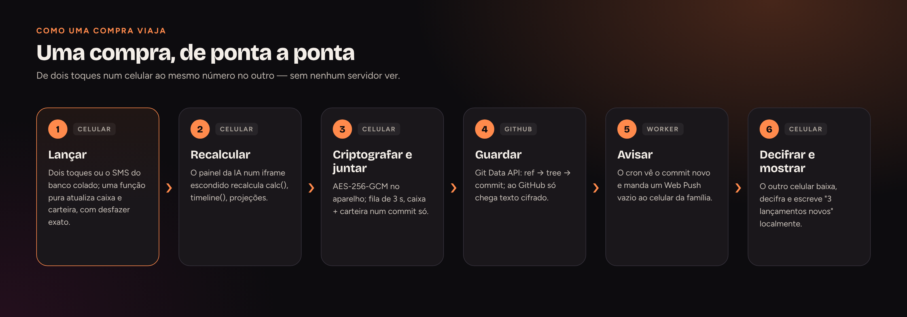
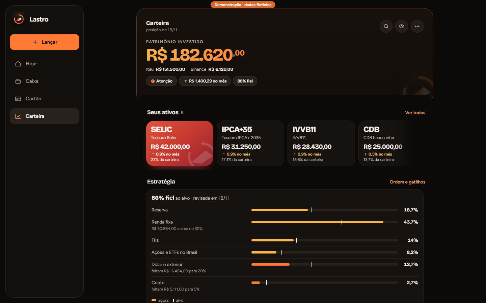

  <a href="https://bebernos.github.io/Lastro-Business/"><b>▶ Demonstração ao vivo</b></a> ·
  <a href="README.md">Read in English</a> ·
  <a href="docs/architecture.pt-BR.md">Arquitetura</a> ·
  <a href="SECURITY.md">Segurança</a> ·
  <a href="docs/case-study.pt-BR.md">Estudo de caso</a>

# Lastro

**O Lastro é um app de finanças pessoais (PWA, feito para o celular) que junta num lugar só o caixa do mês, o cartão de
crédito e a carteira de investimentos de uma família — com um analista de IA (o Claude) fazendo o trabalho pesado de
análise e criptografia de ponta a ponta protegendo cada número.**

Ele foi feito para uma família de verdade e é usado todo dia desde outubro de 2026: quem cuida das contas lança as compras
do cartão a partir do SMS do banco em dois toques, o resto da família acompanha tudo no próprio celular e, uma vez por
mês, a IA fecha o mês, revisa o plano e escreve as análises.

**Em números:** v9.12 (46 versões no histórico) · uso diário desde out/2026 · ~13 mil linhas, 0 dependências · AES-256-GCM de ponta a ponta · ≈260 checagens de regressão + 62 de ponta a ponta

> A demonstração usa uma **família fictícia** (Marina, Rafael, Theo e a gata Mia), gerada na hora, com as datas sempre
> andando junto com o calendário. Nada sai do seu navegador.

## O que ele faz

 <i>Uma compra entra e o "ainda dá para gastar" atualiza na hora — depois sincroniza, criptografado, com a família.</i>

**Em detalhe**
- **Caixa do dia a dia** — quanto ainda dá para gastar no mês, o calendário de contas, "pago / a receber" com um toque e uma
  projeção de 12 meses que mostra os meses apertados antes de chegarem.
- **Cartão de crédito** — cada compra, parcela e assinatura; orçamento por categoria com alertas em 80% e 100%; exportação real
  da fatura em Excel; compras coladas direto do SMS do banco (várias de uma vez).
- **Investimentos** — carteira por ativo e classe, estimativa de hoje com cotações públicas, dividendos, metas, plano de
  alocação, escada de liquidez e simulador de troca na renda fixa.
- **Dois celulares, uma verdade** — quem cuida publica, o celular da família recebe um push ("3 lançamentos novos") e decifra
  localmente.

## Como funciona

O Lastro nasce de uma ideia incomum — **o painel mensal da IA é o motor de cálculo** — e de uma regra dura: **nenhum servidor
pode ver dados financeiros**. Todo o resto decorre dessas duas.

**No aparelho** — Cerca de 13 mil linhas de JavaScript puro, sem framework. Cada ação financeira é uma função pura `JSON → JSON` (lançar compra, marcar pago, aportar, resgatar) que mantém os totais que o painel confere, deixa trilha de auditoria e guarda o estado anterior cifrado para desfazer exato.

**O motor do painel** — Todo mês o Claude produz um painel HTML autossuficiente (código + dados JSON). O Lastro o carrega num iframe escondido e chama as funções dele (`calc()`, `timeline()`, `projecao12()`…); um tradutor transforma cada bloco em telas nativas, então um bloco que a IA inventar no mês seguinte aparece sem versão nova.

**Criptografia** — Os dados são cifrados no celular com AES-256-GCM (chave do PBKDF2-SHA256, 600 mil rodadas); no celular de quem cuida, a chave é selada pela digital pela extensão PRF do WebAuthn. GitHub e Cloudflare só veem texto cifrado; as notificações vão vazias.

**Armazenamento e borda** — Um repositório privado no GitHub é o banco: caixa e carteira são publicados juntos num commit pela Git Data API, juntados numa fila de 3 segundos. Um Worker do Cloudflare com Durable Object observa os arquivos publicados, dispara os pushes, guarda cotações públicas em cache e hospeda o servidor MCP.

**O ciclo com a IA** — O fechamento do mês é um ritual guiado em três passos (carteira → caixa → plano). No dia a dia, o Claude lê um resumo ou campos inteiros e grava análises e planos pelo conector MCP — com simulação antes e o ok do usuário.

### O fluxo

### Decisões de projeto

| Decisão | Por quê |
|---|---|
| **O painel é o motor** | Uma fonte só para a matemática; o app nunca discorda da IA. |
| **GitHub como banco cifrado** | Grátis, versionado e auditável; um commit por sincronização. |
| **Chave selada pela digital (WebAuthn PRF)** | Nada legível nos servidores — nem no aparelho. |
| **Notificações vazias** | O serviço de push nunca vê conteúdo; o celular decifra e escreve o texto. |

Em profundidade: [docs/architecture.pt-BR.md](docs/architecture.pt-BR.md).

## Segurança

Os dados financeiros são cifrados no celular (AES-256-GCM, chave derivada por PBKDF2-SHA256 com 600 mil iterações) antes
de sair dele; o GitHub e a Cloudflare só veem dado cifrado. No celular de quem publica, a chave é selada pela digital
(extensão PRF do WebAuthn): nada legível fica guardado no aparelho. Detalhes e a única exceção opcional (o conector da IA)
em [SECURITY.md](SECURITY.md).

## Destaques de engenharia

- **Zero dependências.** ~13 mil linhas de JavaScript puro (módulos ES), sem framework e sem etapa de build — incluindo
  um gerador de `.xlsx` próprio, gráficos em SVG e o envio de Web Push (VAPID/ES256).
- **Sem servidor próprio, no plano grátis.** App estático + um Worker da Cloudflare com Durable Object (SQLite) para as
  inscrições de push, o cache de cotações e o servidor MCP. O GitHub é o banco de dados (arquivos cifrados, um commit por
  sincronização).
- **Testado como produto.** Bateria de regressão em Playwright (≈260 verificações), ponta a ponta (62: quem lança publica,
  o celular da família recebe, os dois batem) e mais de 30 arquivos de teste de unidade — rodados com dados no formato real
  antes de cada versão.
- **Funções puras em toda operação financeira** (`JSON → JSON`): o desfazer é exato e cada mudança fica rastreável.
- **Acessibilidade e movimento com cuidado**: contraste ≥ 4,5:1 nos dois temas, `prefers-reduced-motion`, rótulos para
  leitor de tela.
- **PWA que funciona sem internet**: cache no service worker, recebe arquivos e texto de SMS pelo Compartilhar, atalhos no ícone.

 <i>O mesmo app no computador.</i>

## Tecnologias

JavaScript (ES2023, sem framework) · HTML/CSS · Service Worker · Web Crypto (AES-GCM, PBKDF2, HKDF) · WebAuthn PRF ·
Web Push (VAPID) · IndexedDB · Cloudflare Workers + Durable Objects · API do GitHub (Git Data) · Model Context Protocol (MCP) ·
Claude · Playwright · Node.js

## Para ler mais

- [Estudo de caso](docs/case-study.pt-BR.md) — o problema, as decisões e o que saiu delas.
- [Arquitetura](docs/architecture.pt-BR.md) — fluxo dos dados, o painel como motor, sincronização e o conector MCP.
- [Segurança](SECURITY.md) — modelo de ameaça e como cada camada funciona.

## O conjunto

| | |
|---|---|
| [**Lastro**](https://github.com/BeBernos/Lastro-Business) | Finanças da família — caixa, cartão e investimentos, com criptografia de ponta a ponta |
| [**Mesa**](https://github.com/BeBernos/Mesa-Business) | Plano alimentar da família, montado por IA |
| [**Pulse**](https://github.com/BeBernos/Pulse-Business) | Treino de força com programas montados por IA e animações 2D/3D dos exercícios |
| [**Cesta**](https://github.com/BeBernos/Cesta-Business) | Pesquisa de preços de mercado, rota de compra e conferência da nota |

## Sobre

Desenhado e construído por **Bruno Bernos** — produto, UX e engenharia — com o Claude Code como par de programação.
Contato: [github.com/BeBernos](https://github.com/BeBernos).

## Licença

Copyright © 2026 Bruno Bernos. **Todos os direitos reservados.** O código está publicado só para avaliação; não há
permissão para usar, copiar, modificar ou distribuir. Veja [LICENSE](LICENSE). Interesse comercial: entre em contato.
