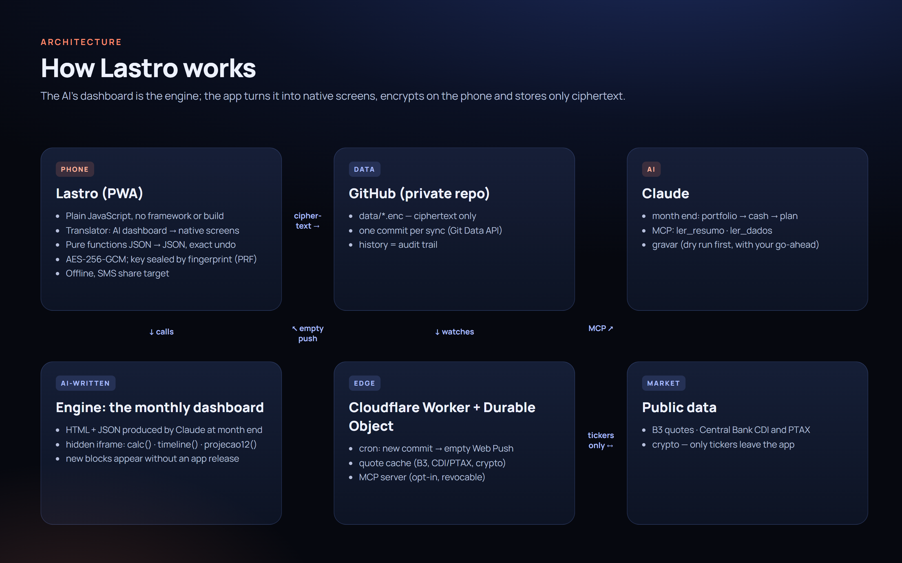
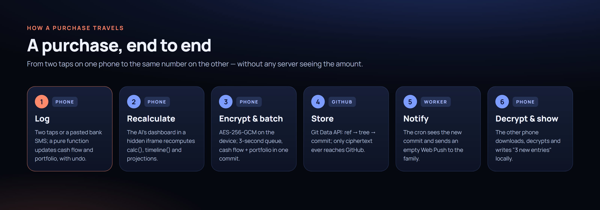

# Architecture

*[Leia em português](architecture.pt-BR.md)*

## Constraints that shaped it

1. **No backend to maintain** and no monthly bill — one person builds and runs it.
2. **No server may see financial data** (see [SECURITY.md](../SECURITY.md)).
3. **The heavy analysis is done by an AI** (Claude) once a month; the app must never disagree with it.
4. **Two phones** must always show the same numbers, including offline.

## Components

| Piece | Where | Role |
|---|---|---|
| PWA (`app/`) | Static files on Cloudflare | All UI, data entry, encryption, sync, offline cache |
| Dashboard (from the AI) | Hidden iframe inside the app | The calculation engine |
| Encrypted store | Private GitHub repo (`data/*.enc`) | Source of truth, versioned by Git |
| Worker (`worker/`) | Cloudflare Workers + Durable Object (SQLite) | Push fan-out, quote cache, read-only API relays, MCP server |
| Claude | claude.ai Project + MCP connector | Monthly closing, plan reviews, analyses |

## The dashboard is the engine

Every month Claude generates a self-contained HTML dashboard: code plus the month's data in
`<script type="application/json" id="cashflow-data">`. Instead of re-implementing its math (and drifting from it),
Lastro loads that HTML into a hidden `iframe srcdoc` and **calls its functions** — `calc()`, `timeline()`,
`projecao12()`, `sobraSegura()`, `score()`… (`app/resumo.js → lerMotor()`). Each call is optional and guarded; only
`calc` and `timeline` are required, otherwise the app falls back to showing the original dashboard.

A **translator** (`app/traduzir.js`) walks every section of the dashboard and converts each block — cards, KPIs, tables,
bar charts, agendas, simulators — into native app components, placed by a routing table (`LUGARES` in `app/telas.js`).
Unknown blocks become text in a default tab, so **a block the AI invents next month appears in the app without a
release**. Interactive controls keep a `data-proxy` selector: tapping them in the app clicks the original inside the
iframe, re-reads the engine and redraws only what changed.

## Writing data: pure functions

Every user action is a pure function `JSON → JSON` (`app/lancamentos.js`, `app/investimentos.js`): log a card purchase
(with installments, refunds, subscriptions, next-bill cycle), mark paid, edit with a scope ("this month only / this and
next / only next"), invest, redeem, dividends. Each keeps the totals the dashboard checks (bill = sum of categories,
scheduled vs. free spending), leaves an audit trail and stores the encrypted previous state for **exact undo**.
Cash flow and portfolio are kept in sync by `sincronizar(before, after, portfolio)`: a contribution in the cash flow moves
the asset (quantity, average price) in the portfolio.

## Sync

- Actions queue for 3 seconds, then publish **cash flow and portfolio in a single commit** through the Git Data API
  (ref → tree → commit → ref update, one retry on conflict).
- Network failure → automatic retries (30 s … 10 min) and a discreet "waiting to send" bar; problems only the user can
  fix (expired token) show a fixed notice with **Fix**.
- A cron in the Worker checks the published files every minute; on change it sends an **empty Web Push** to subscribed
  phones. The receiving phone downloads, decrypts and writes "Marina logged 3 entries" locally.

## Live estimate

`/cotacoes` in the Worker fetches B3 quotes, CDI/PTAX from the Central Bank of Brazil and crypto prices, caching in the
Durable Object (15 min during trading hours). The app sends only tickers and the reference date and computes
"today's estimate" on the device: official value × variation since the position date.

## The AI loop

- **Monthly closing**: the app guides three steps (portfolio → cash flow → plan), each one *send file → copy prompt →
  import the result*, locked in order.
- **Day to day**: with the **MCP connector** on, Claude reads a summary or whole fields (`ler_resumo`, `ler_dados`) and
  writes analyses, plan and allocation targets (`gravar`, with a dry run first). The Worker decrypts, merges with the same
  partial-merge code the app uses (`app/parcial.js`), re-encrypts and commits.

## Demo mode

`app/modo.js` exports a single flag. In this public build it is `true`: the app skips the lock screen, generates a
fictitious family relative to today's date (`app/demo/gerar.js`), loads cleaned dashboard templates and never publishes.
Everything else is the same code the family uses.

## Testing

- **Unit** (Node): pure functions with fixtures built from real data shapes.
- **Regression** (Playwright, 257 checks): every tab, drawer and sheet, phone and desktop (dark only), no horizontal scroll,
  no `undefined/NaN` on screen.
- **End to end** (62 checks): runs the real Worker with `wrangler dev`, a fake GitHub that understands the Git Data API
  and a fake push service validating VAPID JWTs; the owner logs, publishes, closes and reopens the app, and the second
  phone receives the push and must show identical numbers.
