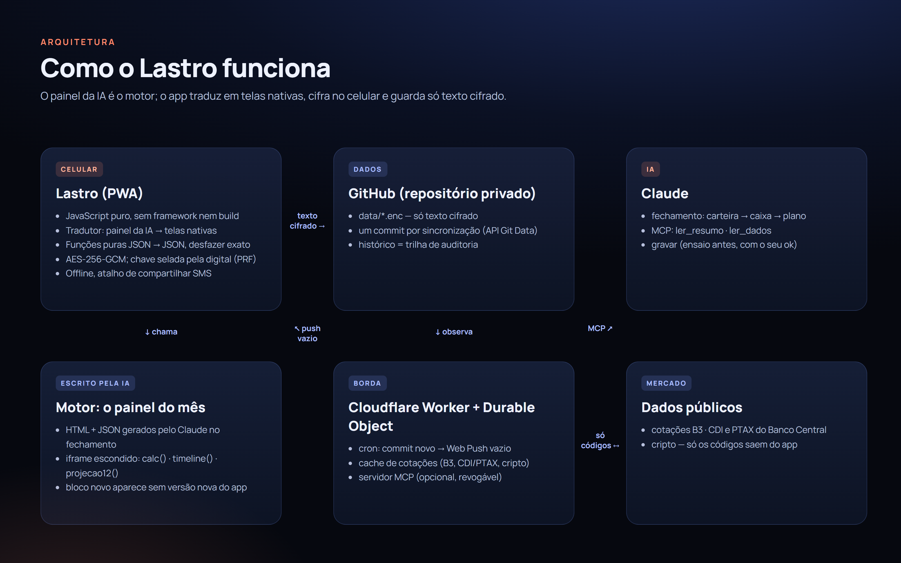
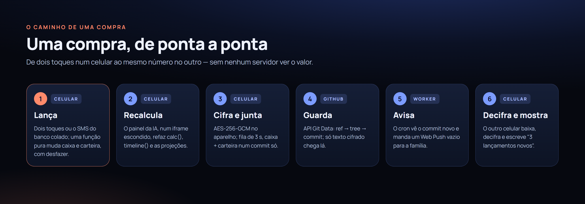

# Arquitetura

*[Read in English](architecture.md)*

## Restrições que deram a forma

1. **Nenhum servidor para manter** e nenhuma conta mensal — uma pessoa constrói e opera.
2. **Nenhum servidor pode ver dado financeiro** (veja [SECURITY.md](../SECURITY.md)).
3. **A análise pesada é da IA** (o Claude), uma vez por mês; o app nunca pode discordar dela.
4. **Dois celulares** mostram sempre os mesmos números, inclusive sem internet.

## Peças

| Peça | Onde | Papel |
|---|---|---|
| PWA (`app/`) | Arquivos estáticos na Cloudflare | Telas, lançamentos, criptografia, sincronização, cache offline |
| Painel (da IA) | Iframe escondido dentro do app | O motor de cálculo |
| Armazenamento cifrado | Repositório privado no GitHub (`data/*.enc`) | Fonte da verdade, versionada pelo Git |
| Worker (`worker/`) | Cloudflare Workers + Durable Object (SQLite) | Notificações, cache de cotações, repasse de APIs só de leitura, servidor MCP |
| Claude | Projeto no claude.ai + conector MCP | Fechamento do mês, revisão do plano, análises |

## O painel é o motor

Todo mês o Claude gera um painel HTML autossuficiente: código mais os dados do mês em
`<script type="application/json" id="cashflow-data">`. Em vez de refazer as contas (e acabar divergindo), o Lastro
carrega esse HTML num `iframe srcdoc` escondido e **chama as funções dele** — `calc()`, `timeline()`, `projecao12()`,
`sobraSegura()`, `score()`… (`app/resumo.js → lerMotor()`). Cada chamada é opcional e protegida; só `calc` e `timeline`
são obrigatórias — sem elas, o app mostra o painel original.

Um **tradutor** (`app/traduzir.js`) percorre cada seção do painel e converte cada bloco — cartões, indicadores, tabelas,
barras, agenda, simuladores — em componentes do app, posicionados por uma tabela de rotas (`LUGARES` em `app/telas.js`).
Bloco desconhecido vira texto numa aba padrão: **o bloco que a IA inventar no mês que vem aparece no app sem versão
nova**. Os controles guardam um seletor `data-proxy`: tocar no app clica o original dentro do iframe, relê o motor e
redesenha só o que mudou.

## Gravar: funções puras

Toda ação é uma função pura `JSON → JSON` (`app/lancamentos.js`, `app/investimentos.js`): compra no cartão (parcelada,
estorno, assinatura, próxima fatura), marcar pago, editar com alcance ("só este mês / este e os próximos / só os
próximos"), aporte, resgate, dividendo. Cada uma mantém os totais que o painel confere (fatura = soma das categorias,
agendado × gasto livre), deixa rastro e guarda o estado anterior cifrado para um **desfazer exato**. Caixa e carteira
andam juntos por `sincronizar(antes, depois, carteira)`: um aporte no caixa mexe no ativo (quantidade, preço médio).

## Sincronização

- As ações esperam 3 segundos numa fila e publicam **caixa e carteira num commit só** pela API Git Data
  (ref → tree → commit → atualiza a ref, refaz uma vez em conflito).
- Falha de rede → tenta de novo sozinho (30 s … 10 min) com uma faixa discreta "aguardando envio"; o que só o usuário
  resolve (token vencido) vira aviso fixo com **Corrigir**.
- Um cron no Worker confere os arquivos publicados a cada minuto e, se mudaram, manda um **Web Push vazio**. O celular
  que recebe baixa, decifra e escreve "Marina lançou 3 coisas" ali mesmo.

## Estimativa ao vivo

A rota `/cotacoes` do Worker busca cotações da B3, CDI/PTAX do Banco Central e preços de cripto, com cache no Durable
Object (15 min no pregão). O app manda só os códigos e a data de referência e calcula a "estimativa de hoje" no próprio
aparelho: valor oficial × variação desde a data da posição.

## O ciclo com a IA

- **Fechamento do mês**: o app guia três etapas (carteira → caixa → plano), cada uma em *mandar o arquivo → copiar o
  pedido → importar a resposta*, travadas em ordem.
- **Dia a dia**: com o **conector MCP** ligado, o Claude lê um resumo ou campos inteiros (`ler_resumo`, `ler_dados`) e
  grava análises, plano e metas de alocação (`gravar`, com validação antes). O Worker decifra, junta com o mesmo código de
  junção parcial que o app usa (`app/parcial.js`), cifra de novo e faz o commit.

## Modo demonstração

`app/modo.js` exporta uma única chave. Nesta versão pública ela vale `true`: o app pula a tela de senha, gera uma
família fictícia a partir da data de hoje (`app/demo/gerar.js`), carrega moldes de painel sem dados e nunca publica.
O resto é o mesmo código que a família usa.

## Testes

- **Unidade** (Node): funções puras com dados no formato real.
- **Regressão** (Playwright, 257 verificações): todas as abas, gavetas e folhas, celular e computador (escuro sempre), sem
  rolagem lateral, sem `undefined/NaN` na tela.
- **Ponta a ponta** (62 verificações): roda o Worker de verdade com `wrangler dev`, um GitHub falso que entende a API
  Git Data e um serviço de push falso que valida o JWT VAPID; quem lança publica, fecha e reabre o app, e o segundo
  celular recebe o push e tem de mostrar os mesmos números.
